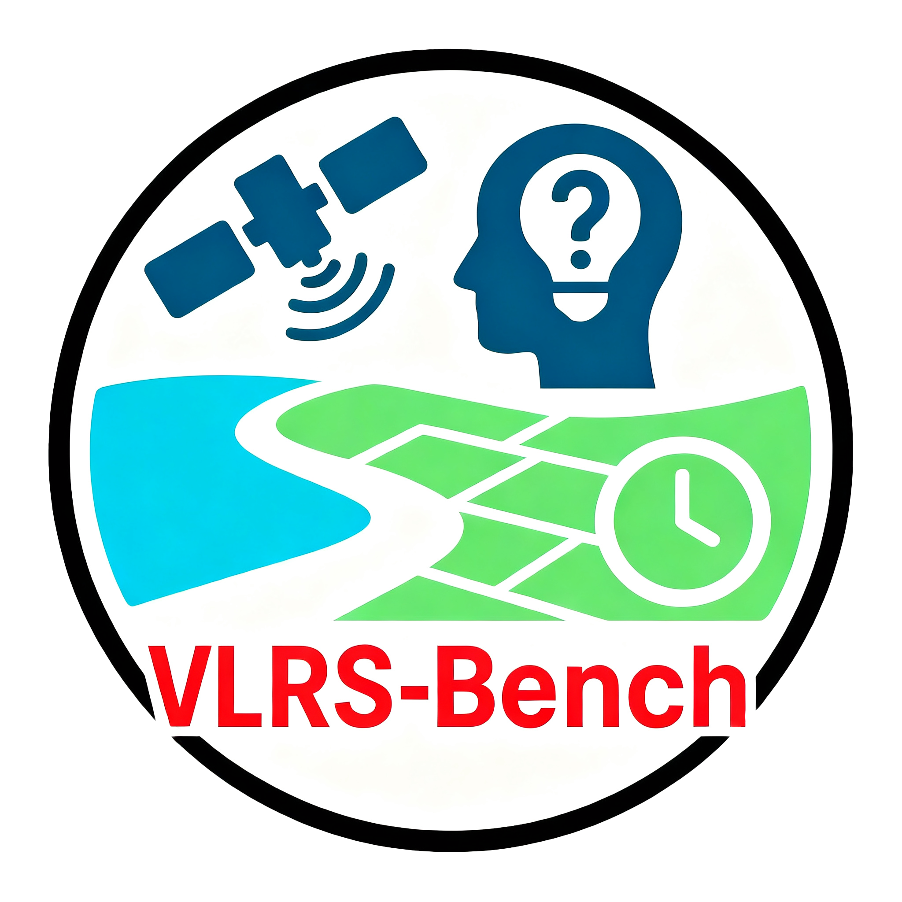
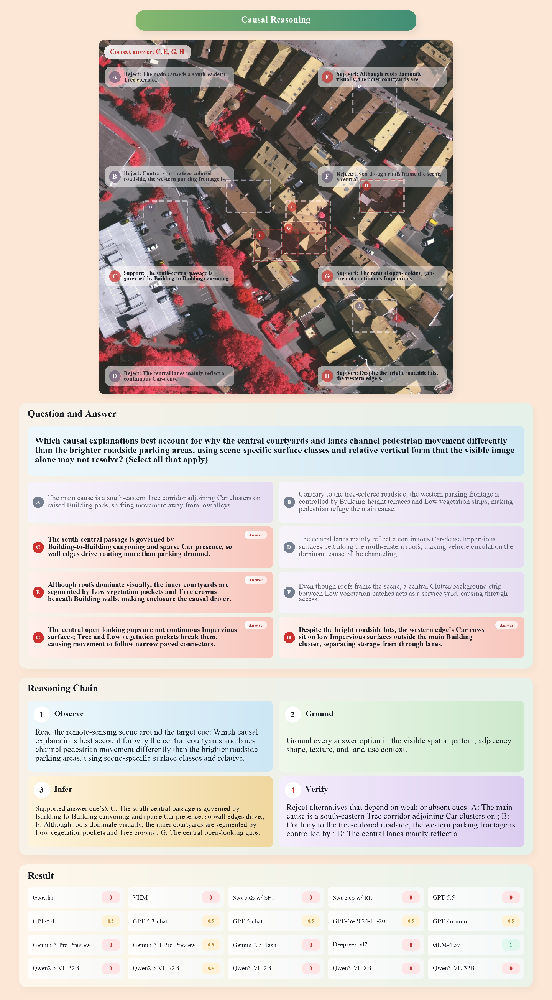
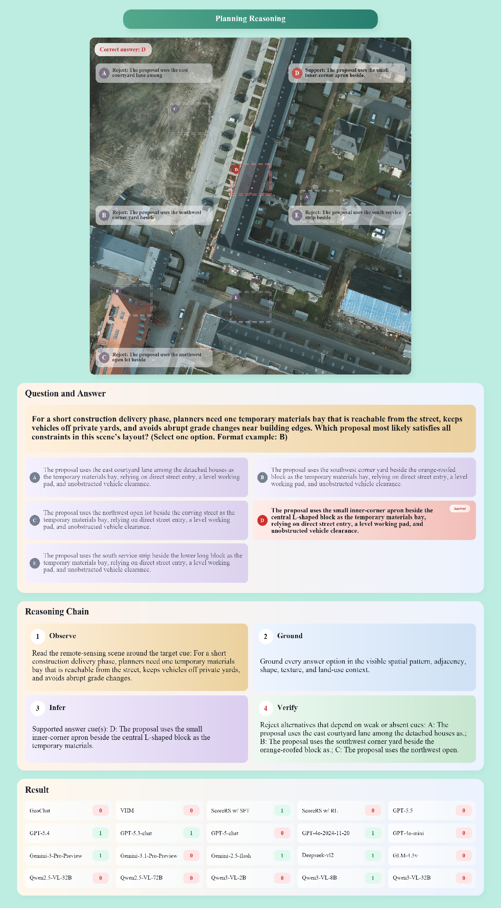
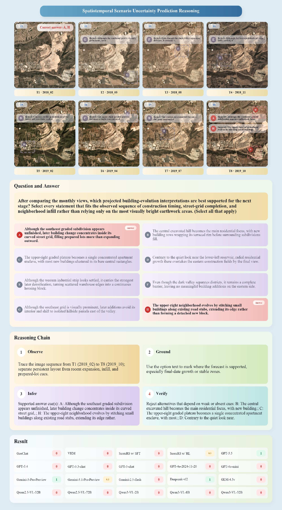
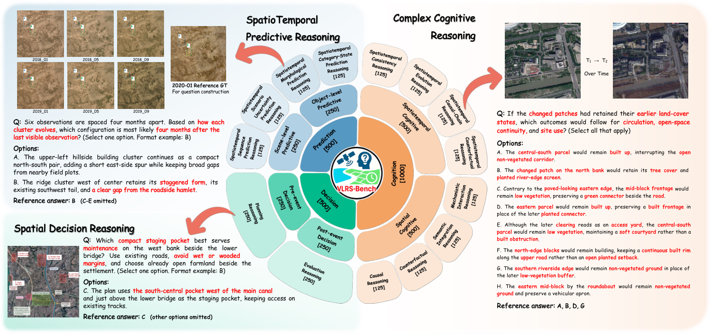
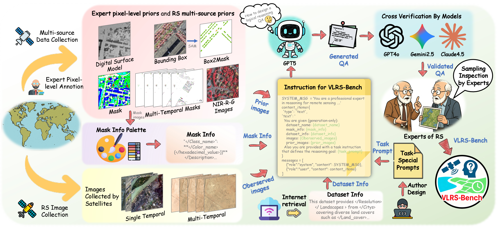

<div align="center">



# VLRS-Bench

### A Vision-Language Reasoning Benchmark for Remote Sensing

[](https://arxiv.org/abs/2602.07045)
[](https://huggingface.co/datasets/thislzm/VLRS-Bench)
[](https://github.com/MiliLab/VLRS-Bench)
[](https://creativecommons.org/licenses/by/4.0/)

**VLRS-Bench evaluates whether multimodal large language models can reason over geospatial scenes, not merely recognize remote-sensing objects.**

[Overview](#overview) · [Examples](#representative-examples) · [Taxonomy](#reasoning-taxonomy) · [Dataset](#dataset) · [Construction](#construction-pipeline) · [Evaluation](#evaluation) · [Citation](#citation)

</div>

---

## Overview

Recent multimodal large language models have made rapid progress in visual understanding, but remote sensing benchmarks still largely emphasize perception tasks such as object recognition, counting, and scene classification. Real Earth-observation applications often require a deeper form of reasoning: explaining why a spatial pattern emerges, deciding what action should be taken under constraints, and predicting how a landscape may evolve.

**VLRS-Bench** is designed for this gap. It is a complex remote sensing reasoning benchmark built around three dimensions:

- **Cognition:** understand causal, counterfactual, mechanistic, semantic, and spatiotemporal relations.
- **Decision:** formulate and evaluate spatial plans under operational constraints.
- **Prediction:** forecast object-level and scene-level future states from temporal evidence.

### Key Numbers

| Property | Value |
|---|---:|
| QA pairs | **2,000** |
| Images | **3,180** |
| Reasoning dimensions | **3** |
| Ability groups | **6** |
| Fine-grained tasks | **14** |
| QA formats | **4** |
| Average question length | **129.87 words** |
| Temporal phases per item | up to **8** |
| Source datasets | **10 public RS datasets** |

## Representative Examples

The three examples below are selected from the detailed case visualizations in the paper appendix. They show how VLRS-Bench moves from static spatial reasoning to operational decision-making and multi-temporal forecasting.

<table>
  <tr>
    <td align="center" width="33%">
      
      <br>
      <b>Cognition</b><br>
      Causal reasoning over spatial structure
    </td>
    <td align="center" width="33%">
      
      <br>
      <b>Decision</b><br>
      Planning under operational constraints
    </td>
    <td align="center" width="33%">
      
      <br>
      <b>Prediction</b><br>
      Multi-temporal scenario forecasting
    </td>
  </tr>
</table>

## Reasoning Taxonomy

VLRS-Bench decomposes remote sensing reasoning into 3 L-1 dimensions, 6 L-2 ability groups, and 14 L-3 tasks.

<div align="center">
  
</div>

### Cognition

| Ability group | Task | What it evaluates |
|---|---|---|
| Spatial Cognitive | `CR` Causal Reasoning | Inferring latent causes behind observed spatial patterns |
| Spatial Cognitive | `CFR` Counterfactual Reasoning | Reasoning under hypothetical spatial interventions |
| Spatial Cognitive | `MIR` Mechanistic Interaction Reasoning | Inferring physical interactions and feedback mechanisms |
| Spatial Cognitive | `SIR` Semantic Integration Reasoning | Integrating local cues into high-level regional semantics |
| Spatiotemporal Cognitive | `ST-CCR` Spatiotemporal Causal-Chain Reasoning | Explaining causal event chains across time |
| Spatiotemporal Cognitive | `ST-CFR` Spatiotemporal Counterfactual Reasoning | Inferring alternative temporal trajectories |
| Spatiotemporal Cognitive | `ST-ER` Spatiotemporal Evolution Reasoning | Understanding functional transformation over time |
| Spatiotemporal Cognitive | `ST-CR` Spatiotemporal Consistency Reasoning | Checking temporal coherence under geospatial constraints |

### Decision

| Ability group | Task | What it evaluates |
|---|---|---|
| Pre-event Decision | `PR` Planning Reasoning | Generating spatially feasible plans under constraints |
| Post-event Decision | `ER` Evaluation Reasoning | Auditing the feasibility and robustness of proposed plans |

### Prediction

| Ability group | Task | What it evaluates |
|---|---|---|
| Object-level Predictive | `ST-CS-PR` Category-State Prediction | Predicting semantic state transitions of entities |
| Object-level Predictive | `ST-M-PR` Morphological Prediction | Forecasting geometric shape or footprint evolution |
| Scene-level Predictive | `ST-SU-PR` Scenario Uncertainty Prediction | Modeling multiple plausible future trajectories |
| Scene-level Predictive | `ST-SQ-PR` Sequence Prediction | Predicting the next stage in a temporal scene sequence |

## Dataset

The released benchmark is hosted on Hugging Face:

- Dataset page: [huggingface.co/datasets/thislzm/VLRS-Bench](https://huggingface.co/datasets/thislzm/VLRS-Bench)
- Annotation file: [`VLRS-Bench.json`](https://huggingface.co/datasets/thislzm/VLRS-Bench/blob/main/VLRS-Bench.json)
- Image folder: [`images/`](https://huggingface.co/datasets/thislzm/VLRS-Bench/tree/main/images)

The JSON file uses a conversation-style structure:

```json
{
  "id": "VLRS_00001",
  "job": "PR",
  "qa_type": "fill_blank",
  "image": ["images/img_00001.jpg"],
  "conversations": [
    {
      "from": "human",
      "value": "<image>\n..."
    },
    {
      "from": "gpt",
      "value": "..."
    }
  ],
  "times": []
}
```

For multi-temporal samples, `image` contains multiple ordered image paths and `times` stores the corresponding temporal labels.

### Loading Example

```python
from datasets import load_dataset
from huggingface_hub import hf_hub_download
from PIL import Image

repo_id = "thislzm/VLRS-Bench"

dataset = load_dataset(
    "json",
    data_files=f"https://huggingface.co/datasets/{repo_id}/resolve/main/VLRS-Bench.json",
    split="train",
)

sample = dataset[0]
print(sample["id"], sample["job"], sample["qa_type"])
print(sample["conversations"][0]["value"])
print(sample["conversations"][1]["value"])

image_path = hf_hub_download(
    repo_id=repo_id,
    repo_type="dataset",
    filename=sample["image"][0],
)
image = Image.open(image_path).convert("RGB")
```

## Construction Pipeline

VLRS-Bench is built through a remote-sensing-aware generation and verification pipeline. During construction, each RGB scene is enriched with auxiliary priors such as DSM, NIR, expert masks, temporal references, dataset metadata, and task-specific prompts.

<div align="center">
  
</div>

The pipeline has four major stages:

1. **Data preparation.** We curate imagery from 10 public remote sensing datasets, including LoveDA, Potsdam, Vaihingen, GID-15, DIOR, FAIR1M, xView2, SECOND, miniUCD, and SpaceNet7.
2. **Prior-enriched instruction synthesis.** RGB imagery is combined with remote sensing priors such as DSM, NIR, expert pixel-level masks, temporal references, mask palettes, and dataset metadata.
3. **Reasoning QA generation.** GPT-5-chat generates QA pairs aligned with the 14 reasoning tasks and four QA formats.
4. **Quality verification.** Items are filtered through automated checks, multi-MLLM cross-validation, and human expert review.

The final benchmark was selected from more than 6,500 generated candidates. Automated filtering and cross-model verification retained 2,694 candidates; nine Ph.D.-level remote sensing experts then reviewed them for professional relevance, logical rigor, visual grounding, and answer correctness, yielding the final 2,000-item benchmark.

## Evaluation

VLRS-Bench uses format-specific scoring:

| Format | Scoring |
|---|---|
| Single-choice | 1 point for the correct option |
| True/false | 1 point for the correct judgment |
| Multi-choice | 1.0 for perfect selections, 0.5 for incomplete but error-free selections, 0 for any incorrect option |
| Fill-in-the-blank | semantic similarity scoring with `all-MiniLM-L6-v2`; partial credit is supported |

Overall scores divide the total points by 2,000. Unanswered questions contribute zero.

## Results Snapshot

VLRS-Bench exposes clear bottlenecks in current MLLMs. Models generally perform better on constrained single-choice and true/false settings, while multi-choice and fill-in-the-blank questions remain substantially harder. Prediction tasks are especially challenging because they require models to extrapolate beyond the directly observed scene and reason over temporal uncertainty.

The paper reports zero-shot results for a broad set of general and remote-sensing-specialized MLLMs, including GPT, Gemini, Claude, Grok, DeepSeek-VL, GLM, Llama, Qwen, GeoChat, VHM, and ScoreRS variants.

## Repository Structure

```text
VLRS-Bench/
├── README.md
├── figs/
│   ├── logo_vlrs.png
│   ├── primary_rrs.png
│   └── figure_rrs.png
└── assets/
    └── readme/
        ├── example_cognition.png
        ├── example_decision.png
        └── example_prediction.png
```

The benchmark annotations and images are hosted on Hugging Face rather than stored directly in this GitHub repository.

## Intended Use

VLRS-Bench is intended for:

- evaluating complex reasoning in general-purpose MLLMs;
- benchmarking remote-sensing-specialized MLLMs beyond perception tasks;
- studying cognition, decision, and prediction abilities in Earth-observation scenarios;
- analyzing multi-image and multi-temporal geospatial QA behavior.

VLRS-Bench is a research benchmark and should not be used as the sole basis for high-stakes operational decisions such as disaster response, emergency planning, or infrastructure deployment.

## Citation

If VLRS-Bench is useful for your research, please cite:

```bibtex
@article{luo2026vlrsbench,
  title   = {VLRS-Bench: A Vision-Language Reasoning Benchmark for Remote Sensing},
  author  = {Luo, Zhiming and Wang, Di and Wang, Hebaixu and Guo, Haonan and Zhang, Jing and Du, Bo},
  journal = {arXiv preprint arXiv:2602.07045},
  year    = {2026}
}
```

## License

VLRS-Bench is released under the Creative Commons Attribution 4.0 International license. Source images are subject to the licenses and terms of their original public datasets.

---

<div align="center">
Maintained by the VLRS-Bench team.
</div>
